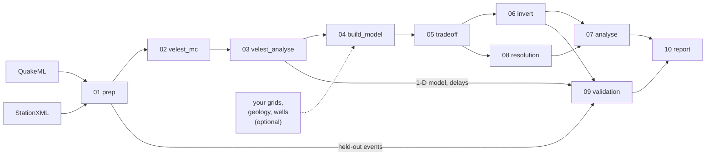

# openSeisVelocity

openSeisVelocity (`osv`) is a reproducible workflow for earthquake-based seismic velocity
inversion of microseismic data. Given a QuakeML catalogue and StationXML metadata it:

1. cleans and quality-controls events, picks and stations (Stage 1, `osv prep`);
2. finds a minimum 1-D P velocity model (plus Vp/Vs and station delays) by running VELEST from
   hundreds of random starting models (Stage 2, `osv velest-mc`, `osv velest-analyse`);
3. builds a 3-D starting model from the 1-D result and, optionally, your own grids, geology
   horizons and well logs (Stage 3, `osv build-model`);
4. chooses damping and smoothing with L-curves and runs the FMTOMO 3-D inversion with event
   relocation (Stage 4, `osv tradeoff`, `osv invert`);
5. analyses the result (Stage 5, `osv analyse`) and tests what is resolved with checkerboard,
   spike and anomaly recovery tests (Stage 6, `osv resolution`);
6. validates the result on held-out events against 1-D relocation (Stage 7, `osv validation`);
7. collects everything into an HTML project report (`osv report`).

Every stage writes into its own numbered directory with a `manifest.json` (inputs, outputs, QC
checks, summary numbers), `figures/` and a `report.html`. Stages that are up to date are
skipped, so you can edit the config and re-run only what changed.

## Pipeline



The stage directories are created under `project.workdir` (default `runs/`):
`01_prep`, `02_velest_mc`, `03_velest_analyse`, `04_build_model`, `05_tradeoff`, `06_invert`,
`07_analyse`, `08_resolution`, `09_validation`, `10_report`. The resolution stage can also feed
resolvable-volume masks back into the analysis figures (re-run `osv plot analyse` after
`osv resolution`).

## Quick start

```bash
git clone <repo-url> openSeisVelocity && cd openSeisVelocity
./install.sh                 # conda env "osv"; builds VELEST and FMTOMO
conda activate osv
osv doctor                   # check the installation

osv init projects/mysite     # writes a fully commented config.yaml
$EDITOR projects/mysite/config.yaml    # point inputs.stationxml / inputs.quakeml at your data
osv doctor --config projects/mysite/config.yaml
osv run -c projects/mysite/config.yaml # all stages; open <workdir>/index.html when done
```

New to the workflow? Follow the [tutorial](tutorial.md), which walks through a real dataset
stage by stage. Looking for a setting? See the [configuration reference](config_reference.md).
Something went wrong? See [troubleshooting](troubleshooting.md).

## Command line

| Command | What it does |
|---|---|
| `osv init DIR` | Create a project directory with a commented `config.yaml`. |
| `osv doctor [--quick] [-c config.yaml]` | Check tools, smoke-test VELEST/FMTOMO, check disk space. |
| `osv prep`, `velest-mc`, `velest-analyse`, `build-model`, `tradeoff`, `invert`, `analyse`, `resolution`, `validation`, `report` | Run one stage (its upstream stages must be complete). |
| `osv run [--from STAGE] [--to STAGE] [--force]` | Run all (or a range of) stages, skipping those that are up to date. |
| `osv plot STAGE` | Regenerate a stage's figures without re-running it. |
| `osv config show` | Print the resolved settings in use. |

All commands take `-c/--config` (default `config.yaml` in the current directory).
`--force` re-runs a stage even if it is up to date.
