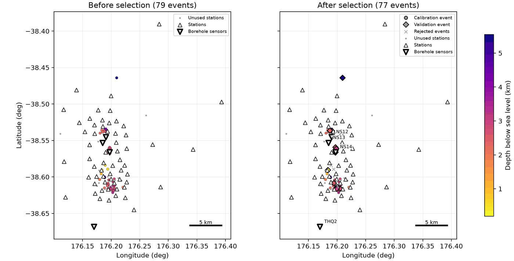
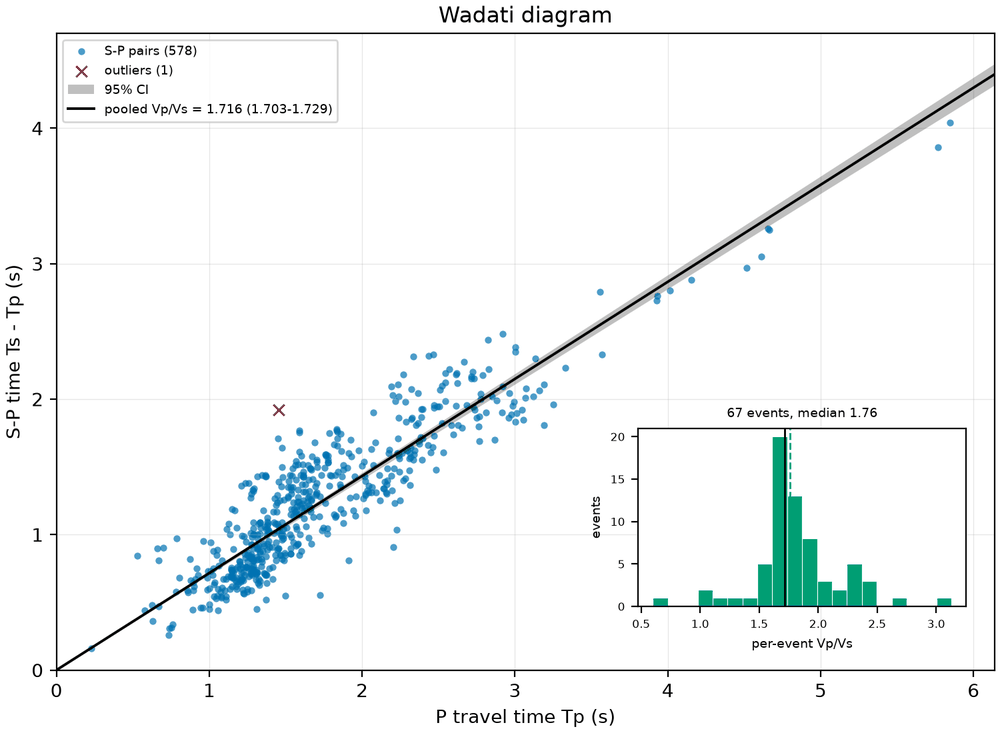
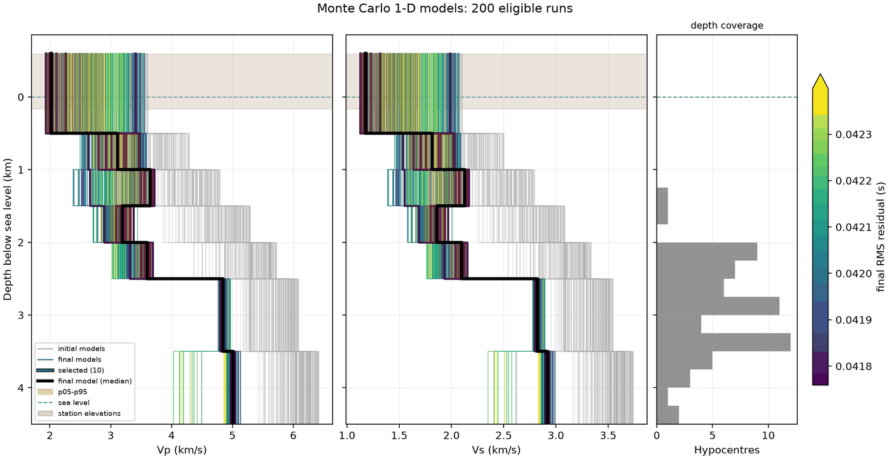
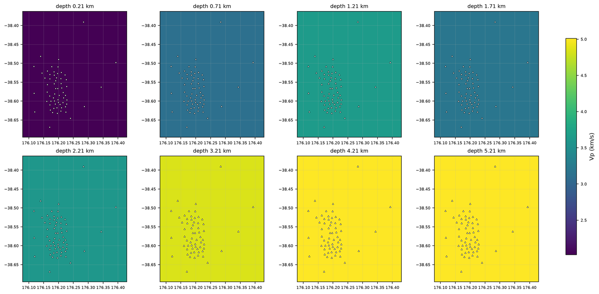
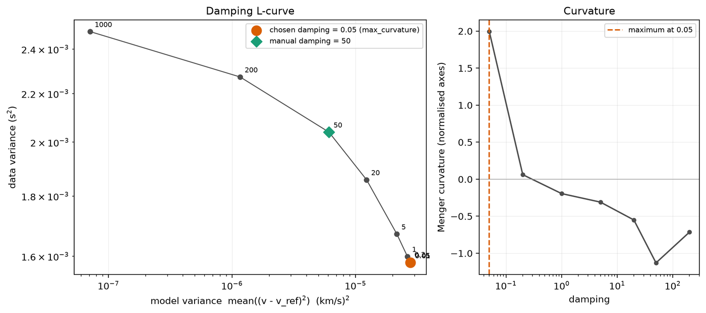
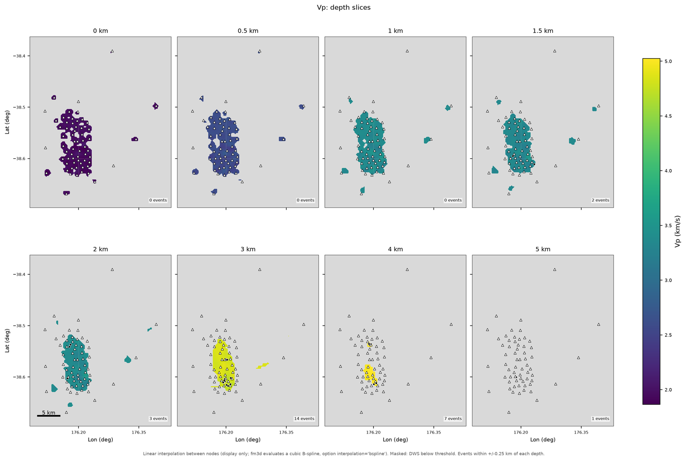
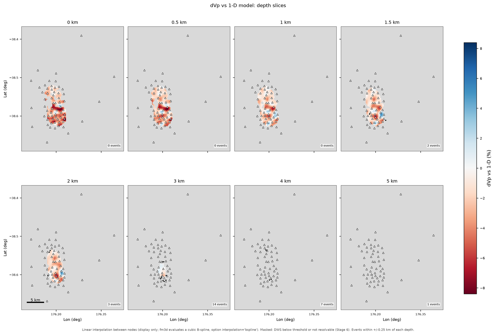
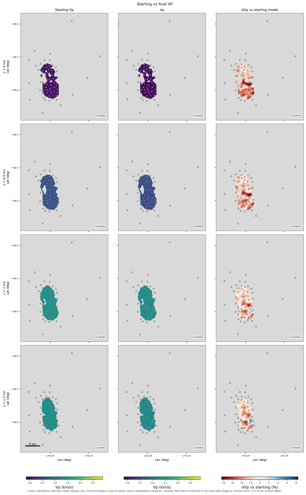
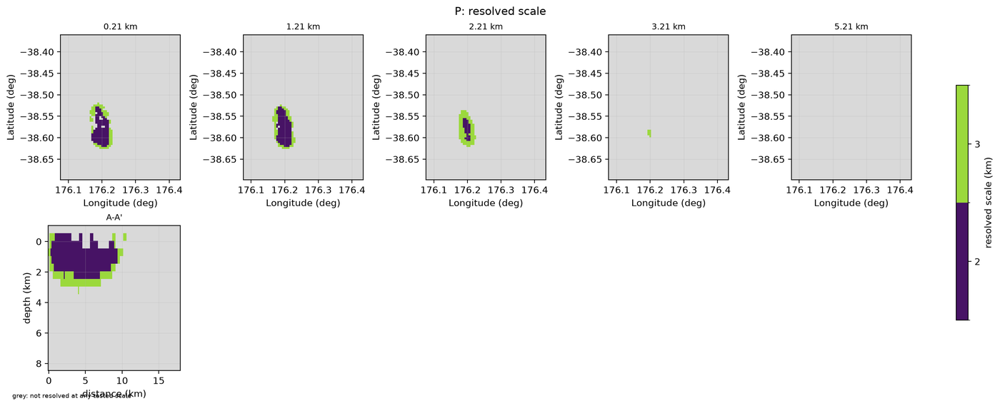
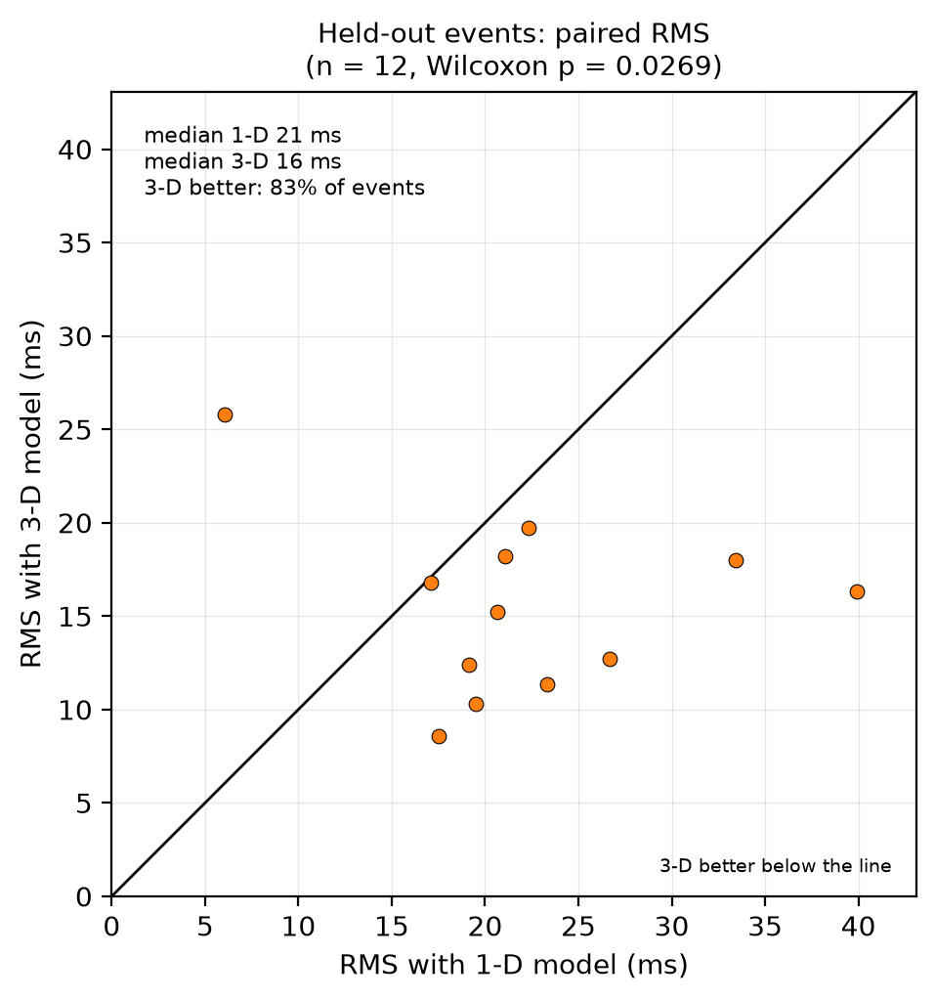

# Tutorial: the rk-nm-2017 example, end to end

This walk-through follows a real run on the project `projects/rk-nm-2017`: 79 manually located
microseismic events and 63 stations at a geothermal field in New Zealand. All numbers below
come from the `manifest.json` summaries of that run (single workstation, 20 jobs; run of 2026-10-17). Your numbers
will differ, but the sequence, the files and the way to read them are the same. Figures are
copied from the run's `figures/` directories.

You need a working installation ([installation](install.md); `osv doctor` must not report FAIL)
and a project directory with a `config.yaml` (see `projects/example/README.md` in the repository
for how to create one). The example project's config points at a QuakeML catalogue
(`manual_only_catalog.xml`) and StationXML files.

```bash
conda activate osv
cd projects/rk-nm-2017
osv doctor --config config.yaml        # tools, smoke tests, disk space, VELEST array limits
osv config show -c config.yaml         # check the settings in use
osv run -c config.yaml                 # everything, about 2.5 hours with 20 jobs
```

You can also run the stages one at a time (`osv prep`, `osv velest-mc`, ...), which is what the
sections below do. Every stage:

* reads its inputs from upstream stage directories (it refuses to run if they are missing);
* writes `<workdir>/NN_name/` with `manifest.json`, `figures/`, `logs/` and `report.html`;
* is skipped on the next `osv run` unless its config section, inputs, upstream runs or tools changed.

Open `<workdir>/index.html` at any time for the project report; it shows what exists so far.

## How to read a stage report

Each `report.html` has the same layout: the stage status and run time, **QC checks** (pass, warn,
fail, each with a message saying what to do), summary numbers, the figures with captions, and the
files written. Failures stop the pipeline; warnings do not, but each one deserves a look. The
`manifest.json` holds the same information in machine-readable form (`status`, `wall_time_s`,
`checks`, `summary`, `outputs`, `error`).

## Stage 1: prepare the data (`osv prep`, 7 s)

```bash
osv prep -c config.yaml
```

Reads the catalogue and StationXML, applies the depth datum, associates picks with station
epochs, flags outliers, applies the selection in `data_selection`, and writes the tables and the
VELEST input files. In the example:

| | Number |
|---|---|
| Events in / selected | 79 / 77 (2 rejected: `min_p`, `max_azgap`) |
| Calibration / validation events | 65 / 12 (`data_selection.validation_fraction: 0.15`) |
| P / S picks selected | 2171 / 674 (of 2231 / 709) |
| Stations with picks | 63 |
| Vp/Vs from Wadati diagrams | 1.716, 95% CI 1.703-1.729 |
| Median azimuthal gap | 51.5 degrees |
| VELEST reference station | NS14 |





Look at: `map_before_after` (did the selection remove what you intended), `wadati` (the points
should follow one straight line; its slope minus one is Vp/Vs), `travel_times`, `rejections`,
`station_residuals` and `picks_per_station`. Details: [Stage 1](stage1_prep.md).

Typical warnings and what to do:

* *"2880 duplicated arrival(s)", "2861 pick(s) are not referenced by any arrival"* - catalogue
  quirks, handled automatically; `inputs.use_arrivals` stays false.
* *"all 79 magnitudes are identical"* - the catalogue has no usable magnitudes; they are marked
  invalid and not used.
* *"4 station(s) have borehole sensors"*, *"10 channel(s) have coordinates inconsistent with their
  station"* - check the StationXML; see [borehole stations](troubleshooting.md#data-preparation).
* *"14 stations have a median travel-time residual exceeding the threshold"* - station delays or
  1-D misfit; Stage 2 estimates station delays.
* *"11 events have a per-event Vp/Vs inconsistent with the median"* - usually few S picks.

## Stage 2: Monte Carlo VELEST (`osv velest-mc`, `osv velest-analyse`)

```bash
osv velest-mc -c config.yaml        # 201 VELEST runs in parallel
osv velest-analyse -c config.yaml   # select, stability tests, delays, Vp/Vs grid, final model, 30 s
```

`velest-mc` draws 200 random starting models (Latin hypercube within `velest.vp_bounds`) plus the
reference model and runs VELEST on each through three damping stages (`p_high_damping`,
`p_free`, `full_frozen_delays`: the P velocities and delays are adjusted first, S information
enters in the last stage). It needs the compiled `velest` binary. `velest-analyse` ranks the
runs, selects the best 5% (`velest.select`), runs perturbation and reference-station stability
tests, repeats VELEST on the final model (`velest.iterate_until`) and writes `final_model.csv`,
`final_model.mod`, station delays and the Vp/Vs grid search.

| | Result |
|---|---|
| Runs ok / diverged | 201 / 1 (0 failed) |
| Runs eligible / selected | 200 / 10 (closest: MC_0063, RMS 0.0418 s) |
| Final model RMS | 0.0418 s (ensemble 0.0418-0.0425 s) |
| Final Vp (km/s), 7 layers | 2.02 (from -0.6 km), 3.11 (0.5), 3.65 (1.0), 3.19 (1.5), 3.60 (2.0), 4.84 (2.5), 5.01 (3.5) |
| Station delays | 61 stations, largest spread 0.04 s (HRRZ) |
| Vp/Vs grid search minimum | 1.68 (Wadati 1.716) |

The ensemble RMS is very tight (0.7 ms), so the information is in the spread of each layer: the
top layer is 2.02 km/s (selected runs 1.93-2.89) and the two deepest layers (4.84 and 5.01 km/s)
agree within 0.03 km/s.



Look at: `velocity_spaghetti` and `velocity_density` (the ensemble spread: narrow where the data
constrain the model), `layer_histograms`, `rms_vs_layer_velocity`, `stability_*` (does the answer
change with the starting hypocentres or the reference station), `station_delay_map` and
`vpvs`. Details: [Stage 2](stage2_velest.md), including how to choose layers and damping.

Typical warnings:

* *"0% of 201 runs converged"* - VELEST stops after four RMS backups, so the ensemble is judged
  by its final RMS; see [VELEST divergence](troubleshooting.md#velest-stage-2). Only 1 run
  diverged here.
* *"layer 3: 100% of the selected runs end within 2% of the lower bound"* and *"final Vp is more
  than 10% of the sampled range beyond the lower bound"* (layers 3, 4 and 6) - the data prefer
  slower layers than the search range allowed; widen `velest.vp_bounds` downwards to test this.
* *"low-velocity zone: layer 3 (3.19 km/s) is 0.46 km/s slower than layer 2"* - switching
  `lowveloclay` changes that layer by 0.42 km/s at the same RMS (0.0420 s), so the zone is not
  well constrained.
* *"the repeat-until-stable loop did not converge in 5 cycles"* - the shallow layers keep
  drifting by up to 0.17 km/s; the best cycle (1) is used.
* *"reference station swapped from NS14 ..."* is an informational line; the Vp deviation is only
  0.03 km/s, so the model does not depend on the reference station.

## Stage 3: build the 3-D starting model (`osv build-model`, 62 s)

```bash
osv build-model -c config.yaml
```

Extrudes the final 1-D model into a 3-D FMTOMO grid (`model3d.grid`), optionally blends in your own
grids, horizons or wells ([user models](user_models.md)), writes every FMTOMO input and traces the
observed rays with `fm3d` as a forward check.

| | Result |
|---|---|
| Source | `velest_1d` |
| Velocity grid | 19 x 75 x 62 = 103,488 nodes at 0.5 km |
| Propagation grid | 55 x 223 x 184 (2.26 M nodes, 0.167 km) |
| Sources / receivers / P observations | 65 / 62 / 1847 |
| Vp range | 2.02-5.01 km/s |
| Forward RMS of the starting model | 0.056 s (0.035 s after removing the mean of +0.043 s) |



Look at: `grid_geometry`, `vp_slices`, `section_*`, and above all the forward-check figures
`residual_histograms`, `residual_distance` and `station_residuals`. A starting model should
fit the picks about as well as VELEST does (0.042 s; here 0.056 s, or 0.035 s once the mean offset is removed); a
much worse fit means a problem with coordinates, the depth datum or station delays. Here the
mean residual is +0.043 s, which the *residual_bias* warning flags; the inversion in Stage 4 takes
the RMS from 56 to 33 ms. Details: [Stage 3](stage3_model.md).

Typical warnings:

* *"node spacing 0.50 km exceeds one third of the median nearest-station spacing (1.19 km)"* -
  the data cannot constrain such a fine grid; the regularisation will do most of the work.
* *"21 receiver(s) were above the interpolated surface; surface lifted locally"* - station
  elevations versus the smoothed surface (`model3d.surface_smoothing_km`).
* *"6 P residuals beyond 5 robust standard deviations"* - look at the stations involved.
* *"P residuals have mean +0.043 s"* and *"mean P residuals correlate with the VELEST station
  delays with r = 0.15"* - the starting model is systematically fast for these picks; see
  [borehole stations and station delays](troubleshooting.md#borehole-stations-and-station-delays)
  for why the VELEST delays are still applied.

## Stage 4: damping, smoothing and the inversion (`osv tradeoff`, `osv invert`)

```bash
osv tradeoff -c config.yaml     # 14 short inversions, about 40 min
osv invert -c config.yaml       # final inversion with relocation, about 6 min
```

`tradeoff` sweeps the damping and smoothing, builds L-curves of data misfit against model norm
and picks the corner by maximum curvature (`fmtomo.tradeoff`). `invert` runs the full
inversion with the chosen values (or the ones you fix in `fmtomo`) and relocates the events.

| | Result |
|---|---|
| Chosen damping / smoothing (P) | 0.05 / 10 (maximum curvature, 14 sweep runs) |
| RMS start to final | 56.3 to 32.6 ms (42.1% misfit reduction, 66.7% variance reduction) |
| Reduced chi-squared | 2.8 |
| Median hypocentre shift | 0.11 km |
| Covered fraction of nodes (DWS) | 2.6% |





Look at: `lcurve_damping` and `lcurve_smoothing` (is the chosen point at a clear corner),
`misfit_vs_iteration` (has it converged), `slices_vp`, `slices_dvp_1d` (perturbation relative to
the 1-D model), `residual_histograms` (centred and narrower than before),
`hypocentre_shifts` and `seismicity_before_after`. Details: [Stage 4](stage4_fmtomo.md).

Typical warnings:

* *"the corner (0.05) is next to the edge of the swept range 0.01..1000"* and the same for the
  smoothing (10, range 1..1000) - the L-curve corner may lie outside the sweep; widen it or set
  the values yourself.
* *"14 of 14 sweep runs still changed their misfit by more than 2%"* - the sweep iterations are
  few (`fmtomo.tradeoff.iterations`); the L-curve is indicative.
* *"misfit increased after iteration 3"* - the linearised step overshoots in the last
  iterations; raise the damping or the smoothing, or stop earlier.
* *"reduced chi-squared is 2.82, not near 1"* - the stated pick uncertainties are smaller than
  the achievable fit; the inversion is an RMS reduction, not a statistical fit.

## Stage 5: analyse the inversion (`osv analyse`, 11 s)

```bash
osv analyse -c config.yaml
```

Computes perturbation statistics, produces the figures and the exports (NetCDF, CSV, VTK) and masks everything the data cannot see (`plotting.dws_mask_threshold`).

Look at: `slices_vp`, `section_a_a`, `compare_start_final_vp`, `variance_reduction`,
`residual_vs_azimuth` and `station_residual_map`. Only 2.6% of the Vp volume has DWS of at least
0.1 here, so most of the model is masked; that is the data, not a bug. After running Stage 6, run
`osv plot analyse -c config.yaml` to add the `_resolvable` figures that show only what the
resolution tests recovered. Details: [Stage 5](stage5_analysis.md).

Anomalies in the shallow (to about 2 km) core of the array are the only part of the model that
passes both the DWS mask and the resolution tests; this is the perturbation relative to the 1-D
model, masked to the resolvable volume (1.4% of all nodes):





## Stage 6: resolution tests (`osv resolution`, about 45 min)

```bash
osv resolution -c config.yaml
```

Inverts synthetic data (checkerboards of 1.5, 2 and 3 km cells, spikes, and your own anomaly
bodies) through the real ray geometry with noise matched to the picks, using the same
regularisation. Six tests ran, all succeeded.

| | Result |
|---|---|
| Covered nodes (P) | 2257 |
| Resolved fraction of covered nodes | 26% at 2 km, 50% at 3 km (shallower than 2.1 km: 36% / 61%; 2.1-5.3 km: 5% / 28%) |
| Median resolved scale | 2 km (smallest anomaly of interest 1.5 km) |



Look at: `true_vs_recovered_slices_*` (does the checkerboard come back where you want to
interpret), `recovery_amp_P` and `recovery_corr_P` (amplitude and correlation recovery),
`resolved_scale_P`, `smearing_spikes_P`. The `resolvable_mask.nc` file marks nodes whose recovery
passes `resolution.mask`. Warning *"median resolved scale 2 km is coarser than the smallest
anomaly of interest"* tells you that features smaller than that must not be interpreted.
Details: [Stage 6](stage6_resolution.md).

## Stage 7: validation (`osv validation`, 130 s)

```bash
osv validation -c config.yaml
```

Relocates the 12 held-out events with VELEST in the final 1-D model and with FMTOMO in the final 3-D
model, using the same picks.

| | Result |
|---|---|
| Median RMS, 1-D / 3-D | 20.9 / 15.8 ms (improvement 7.8 ms, 37%) |
| Events better / worse in 3-D | 83% / 8% (one tie) |
| Wilcoxon p-value | 0.027 (one-sided 0.013) |



Points below the 1:1 line in `validation_rms_scatter` are events that fit better in 3-D. A low
fraction of better events, or a high p-value, means the 3-D model does not generalise. With
only 12 events the test has little power: 10 of 12 events improve and p = 0.027 is below
0.05 on the two-sided test, but a single event can still change that. Details:
[Stage 7](stage7_validation.md).

## The project report (`osv report`)

```bash
osv report -c config.yaml
open runs/index.html
```

Combines everything: pipeline status (9 of 9 stages complete here), all failures and warnings
grouped by stage (0 failures and 25 warnings in the example), headline numbers and key
figures. `10_report/summary.md` is a compact Markdown version to paste into notes.
See [reporting](reporting.md).

## Iterating

* Change a setting in `config.yaml` and run `osv run`: only the affected stages and everything
  downstream re-run.
* To tweak figures only, edit the `plotting` section and run `osv plot STAGE`.
* To redo one stage use `osv STAGE --force`.
* To start over, delete the stage directories (or the whole `workdir`).
* Use [troubleshooting](troubleshooting.md) when a stage fails or a warning is unclear.
